<picture>
  <source media="(prefers-color-scheme: dark)" srcset="assets/banner-dark.png">
  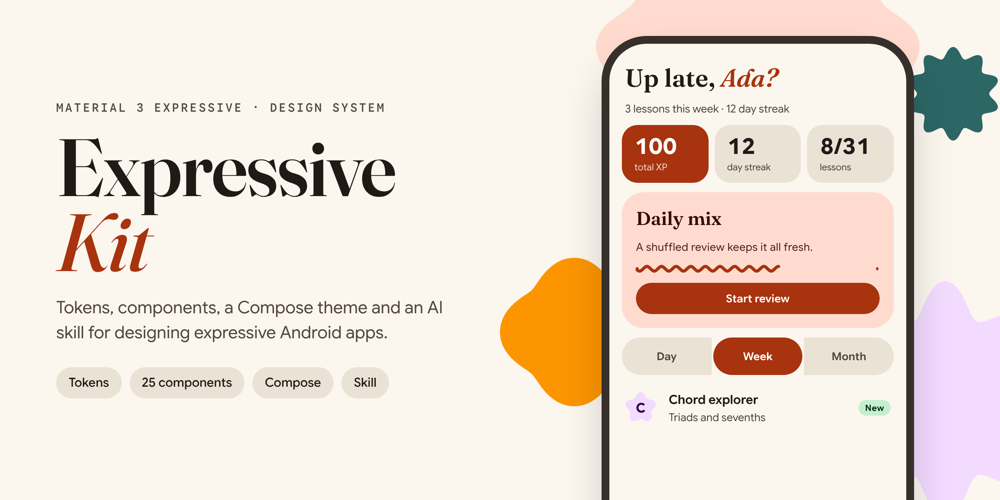
</picture>

# Expressive Kit

**A Material 3 Expressive design system and AI skill.** Use it to design and build expressive Android and web apps, or hand it to an AI tool so it designs in the M3 Expressive style.

- **Design tokens:** 36 colour roles in light and dark (every text pair meets WCAG AA), a 21-style type scale, M3 corner shapes, spacing, elevation, sizes and state opacities.
- **25 components** for the web (React 18), including the new M3 Expressive ones: connected button groups, split buttons, floating toolbars, wavy progress and the morphing loading indicator.
- **A Jetpack Compose theme** generated from the same tokens.
- **An AI skill** ([`SKILL.md`](SKILL.md)) that teaches Claude or any AI tool M3 Expressive shape, motion, emphasis, component patterns and screen patterns.
- **Guidelines:** a [brand book](docs/brand-book.md), [eight screen patterns](docs/screen-patterns.md) and [ten seed palettes](docs/seed-palettes.md).
- **A website** with live components, deployed to GitHub Pages on every merge to `main`.

## Contents

- [Use it](#use-it): as an AI skill, as a Claude design system, on the web, on Android
- [Components](#components)
- [M3 Expressive behaviours](#m3-expressive-behaviours)
- [Repository layout](#repository-layout)
- [Development](#development)

## Use it

### As an AI skill (Claude and other AI tools)

The repository root is a skill: [`SKILL.md`](SKILL.md) plus the files it references.

- **Claude apps:** download `material-3-expressive-skill.zip` from the website (or zip the `SKILL.md`, `tokens/`, `docs/`, `components/` and `android/` into a folder named `material-3-expressive`). Then open Settings → Capabilities → Skills and upload it.
- **Claude Code:** unzip it into `~/.claude/skills/` for all projects, or `.claude/skills/` in one project. Claude uses it whenever you ask for Material 3 Expressive UI.
- **Other AI tools:** add `SKILL.md` to the tool's rules or context. It links to every token, guideline and component file it needs.

Then ask for things like *"Design a settings screen for my podcast app in Material 3 Expressive"* or *"Build this screen in Compose using Expressive Kit"*.

### As a Claude design system

The repository already follows Claude's design system format, so it can be imported without conversion:

| Design system file | In this repository |
| --- | --- |
| Tokens | `tokens/tokens.json` |
| Brand book | `docs/brand-book.md` (plus `docs/screen-patterns.md`, `docs/seed-palettes.md`) |
| Component bundle | `components/bundle.js` (namespace `Expressive`, React 18), `components/bundle.css`, `components/index.d.ts` |
| Component cards | `components/<Name>/preview.html` and `components/<Name>/README.md` |
| Cover | `components/Cover/preview.html` |

In Claude, connect GitHub and ask: *"Create a design system from github.com/dinoy-raj/Material-3-expressive-design-system-skill"*.

### On the web

```html
<link rel="stylesheet" href="tokens/tokens.css">
<link rel="stylesheet" href="components/bundle.css">

<script src="https://cdn.jsdelivr.net/npm/react@18.3.1/umd/react.production.min.js"></script>
<script src="https://cdn.jsdelivr.net/npm/react-dom@18.3.1/umd/react-dom.production.min.js"></script>
<script src="components/bundle.js"></script>
<script>
  const { Button, ButtonGroup } = window.Expressive;
  const h = React.createElement;
  ReactDOM.createRoot(document.getElementById('app')).render(
    h(Button, { size: 'md', fullWidth: true }, 'Review order')
  );
</script>
```

The theme follows the system. Force one with `<html data-theme="light">` or `data-theme="dark"`. To use only the look, load `tokens/tokens.css` and use variables such as `var(--primary)`, `var(--shape-xl)` and `var(--space-4)` and type classes such as `class="headline-large"`.

From another project: `npm install git+ssh://git@github.com/dinoy-raj/Material-3-expressive-design-system-skill.git`, then import `expressive-kit/tokens.css`, `expressive-kit/styles.css` and `expressive-kit`.

### On Android (Jetpack Compose)

Copy [`android/ExpressiveTheme.kt`](android/ExpressiveTheme.kt) into your app module (update the `package` line) and wrap your UI:

```kotlin
ExpressiveTheme {
    Button(onClick = { }) { Text("Review order") }
    val highlight = Expressive.extendedColors.highlight // roles Material 3 has no slot for
}
```

Swap `SansFamily`, `DisplayFamily` and `MonoFamily` for Google Sans Flex, Fraunces and Google Sans Code with downloadable Google Fonts. For the M3 Expressive components and spring motion, use `androidx.compose.material3` 1.4+ (`MaterialExpressiveTheme`, `MotionScheme.expressive()`); [`SKILL.md`](SKILL.md#component-patterns) maps each component.

## Components

Every component has a guideline (`components/<Name>/README.md`) covering what to provide, when to use it, and do's and don'ts. Images switch with your GitHub theme.

### Actions

<table>
<tr><td width="50%" valign="top"><b><a href="components/Button/README.md">Button</a></b><br><picture><source media="(prefers-color-scheme: dark)" srcset="assets/components/Button-dark.png">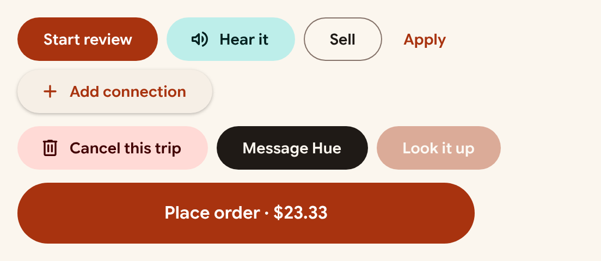</picture><br><sub>Pill-shaped action button that morphs to a squarer corner while pressed.</sub></td><td width="50%" valign="top"><b><a href="components/ButtonGroup/README.md">ButtonGroup</a></b><br><picture><source media="(prefers-color-scheme: dark)" srcset="assets/components/ButtonGroup-dark.png">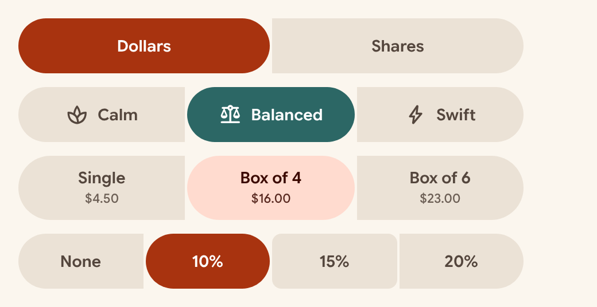</picture><br><sub>Connected button group: single choice among two to five options, with the selected option growing into a full pill.</sub></td></tr>
<tr><td width="50%" valign="top"><b><a href="components/Fab/README.md">Fab</a></b><br><picture><source media="(prefers-color-scheme: dark)" srcset="assets/components/Fab-dark.png">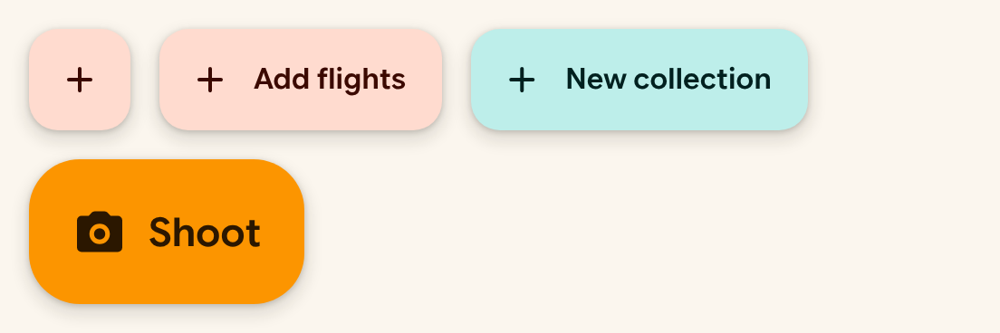</picture><br><sub>Floating action button for the screen's signature action, anchored bottom-right above the navigation bar.</sub></td><td width="50%" valign="top"><b><a href="components/IconButton/README.md">IconButton</a></b><br><picture><source media="(prefers-color-scheme: dark)" srcset="assets/components/IconButton-dark.png">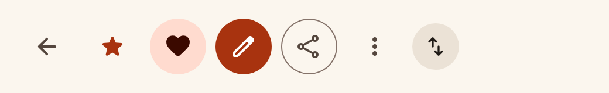</picture><br><sub>Round 48px icon-only control for app-bar actions, favourites and card affordances.</sub></td></tr>
<tr><td width="50%" valign="top"><b><a href="components/SplitButton/README.md">SplitButton</a></b><br><picture><source media="(prefers-color-scheme: dark)" srcset="assets/components/SplitButton-dark.png">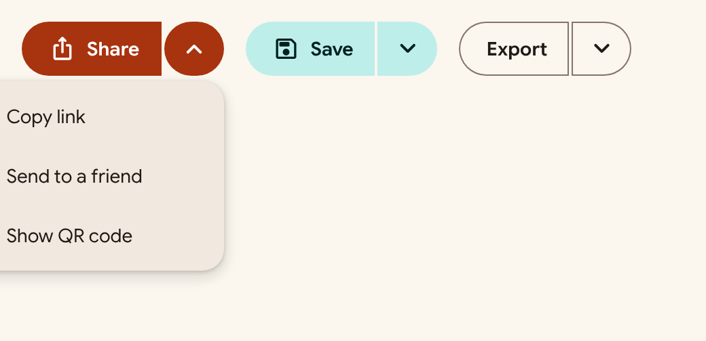</picture><br><sub>A primary action joined to a menu of related actions: the trailing half rounds fully and its chevron turns when the menu is open.</sub></td><td width="50%"></td></tr>
</table>

### Selection

<table>
<tr><td width="50%" valign="top"><b><a href="components/Chip/README.md">Chip</a></b><br><picture><source media="(prefers-color-scheme: dark)" srcset="assets/components/Chip-dark.png">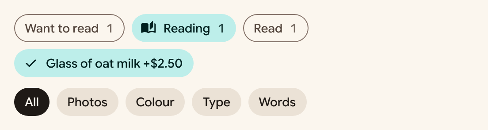</picture><br><sub>Compact, wrapping choices: filters, multi-select extras, suggestions.</sub></td><td width="50%" valign="top"><b><a href="components/Slider/README.md">Slider</a></b><br><picture><source media="(prefers-color-scheme: dark)" srcset="assets/components/Slider-dark.png">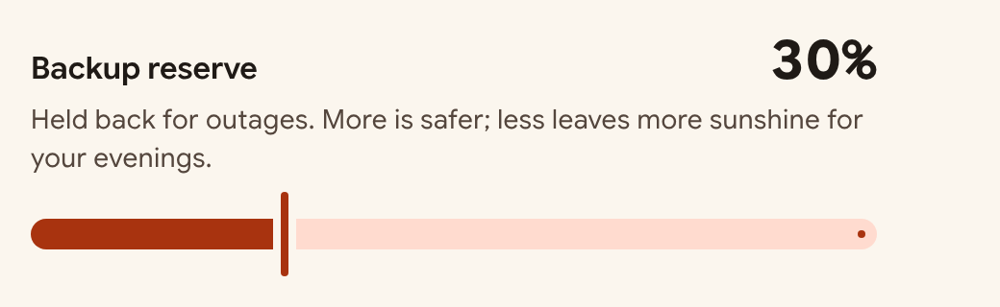</picture><br><sub>Expressive slider: a thick 16px track split by a bar handle, with a stop dot at the end.</sub></td></tr>
<tr><td width="50%" valign="top"><b><a href="components/Switch/README.md">Switch</a></b><br><picture><source media="(prefers-color-scheme: dark)" srcset="assets/components/Switch-dark.png">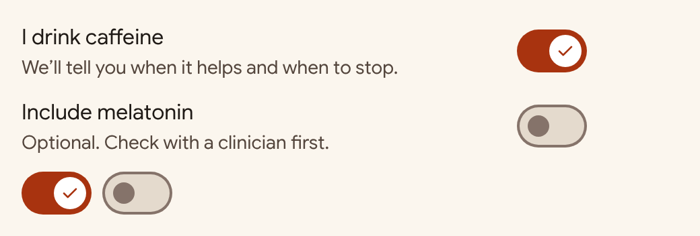</picture><br><sub>On/off toggle that applies immediately, with a check in the thumb when on.</sub></td><td width="50%"></td></tr>
</table>

### Inputs

<table>
<tr><td width="50%" valign="top"><b><a href="components/SearchBar/README.md">SearchBar</a></b><br><picture><source media="(prefers-color-scheme: dark)" srcset="assets/components/SearchBar-dark.png">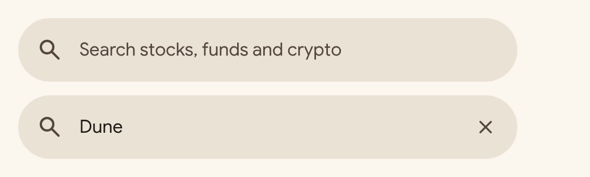</picture><br><sub>Full-width pill search field on surface-container-high.</sub></td><td width="50%" valign="top"><b><a href="components/TextField/README.md">TextField</a></b><br><picture><source media="(prefers-color-scheme: dark)" srcset="assets/components/TextField-dark.png">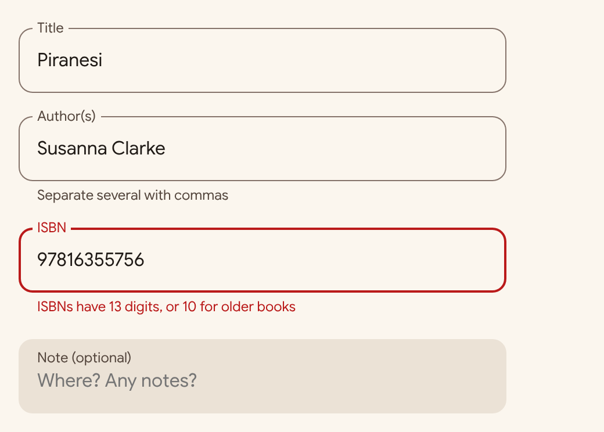</picture><br><sub>Outlined text field with its label notched into the border, or a filled variant for sheets.</sub></td></tr>
</table>

### Navigation

<table>
<tr><td width="50%" valign="top"><b><a href="components/FloatingToolbar/README.md">FloatingToolbar</a></b><br><picture><source media="(prefers-color-scheme: dark)" srcset="assets/components/FloatingToolbar-dark.png">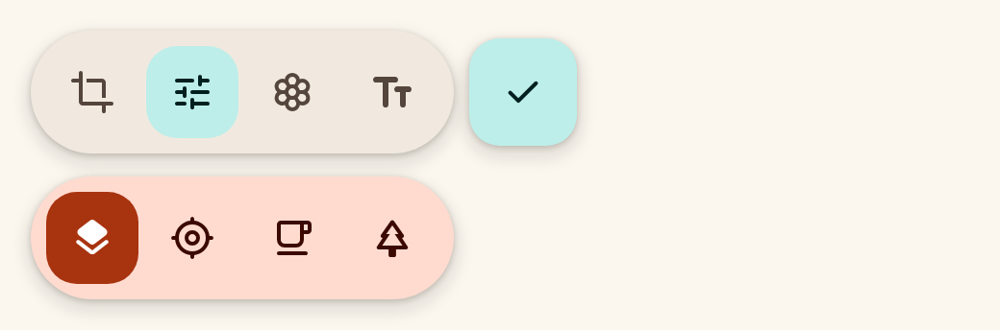</picture><br><sub>A pill of contextual actions that floats above content, often beside a FAB; the M3 Expressive replacement for a bottom app bar.</sub></td><td width="50%" valign="top"><b><a href="components/NavigationBar/README.md">NavigationBar</a></b><br><picture><source media="(prefers-color-scheme: dark)" srcset="assets/components/NavigationBar-dark.png">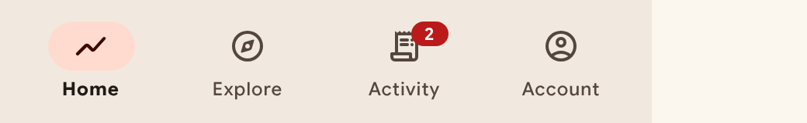</picture><br><sub>Bottom navigation for three to five top-level destinations.</sub></td></tr>
<tr><td width="50%" valign="top"><b><a href="components/TopBar/README.md">TopBar</a></b><br><picture><source media="(prefers-color-scheme: dark)" srcset="assets/components/TopBar-dark.png">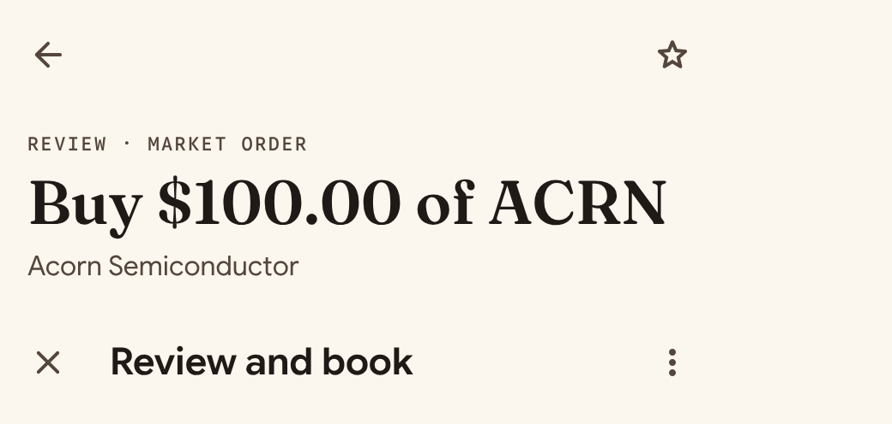</picture><br><sub>Screen header: a large title block for top-level and detail screens, or a small single-line bar for flows.</sub></td><td width="50%"></td></tr>
</table>

### Status

<table>
<tr><td width="50%" valign="top"><b><a href="components/Badge/README.md">Badge</a></b><br><picture><source media="(prefers-color-scheme: dark)" srcset="assets/components/Badge-dark.png">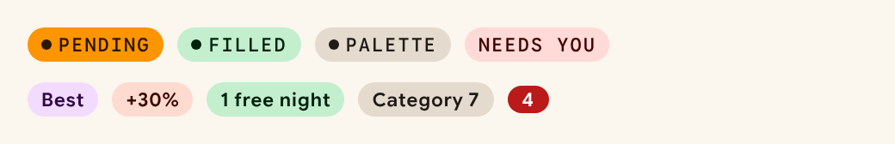</picture><br><sub>Small status pill or count for states, tags and notifications.</sub></td><td width="50%" valign="top"><b><a href="components/LoadingIndicator/README.md">LoadingIndicator</a></b><br><picture><source media="(prefers-color-scheme: dark)" srcset="assets/components/LoadingIndicator-dark.png">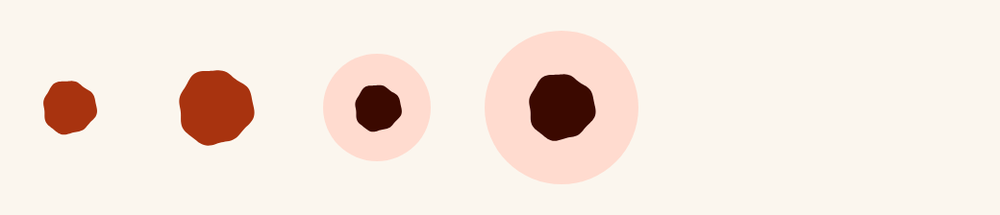</picture><br><sub>Indeterminate loading shown as a shape that morphs through the shape library while it rotates.</sub></td></tr>
<tr><td width="50%" valign="top"><b><a href="components/Snackbar/README.md">Snackbar</a></b><br><picture><source media="(prefers-color-scheme: dark)" srcset="assets/components/Snackbar-dark.png">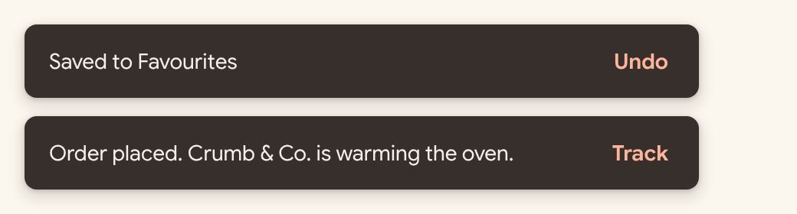</picture><br><sub>Brief confirmation at the bottom of the screen, on inverse-surface, with at most one action.</sub></td><td width="50%" valign="top"><b><a href="components/ValuePill/README.md">ValuePill</a></b><br><picture><source media="(prefers-color-scheme: dark)" srcset="assets/components/ValuePill-dark.png">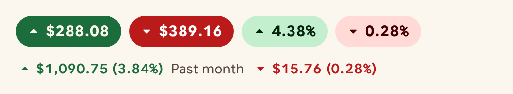</picture><br><sub>Price or percentage with a direction arrow, coloured by gain or loss.</sub></td></tr>
<tr><td width="50%" valign="top"><b><a href="components/WavyProgress/README.md">WavyProgress</a></b><br><picture><source media="(prefers-color-scheme: dark)" srcset="assets/components/WavyProgress-dark.png">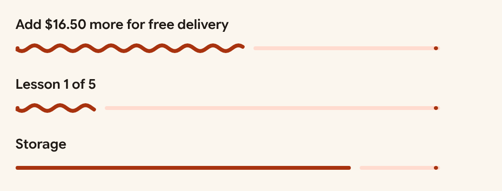</picture><br><sub>Linear progress whose completed part is a wave, ending in a stop dot.</sub></td><td width="50%"></td></tr>
</table>

### Containment

<table>
<tr><td width="50%" valign="top"><b><a href="components/BottomSheet/README.md">BottomSheet</a></b><br><picture><source media="(prefers-color-scheme: dark)" srcset="assets/components/BottomSheet-dark.png">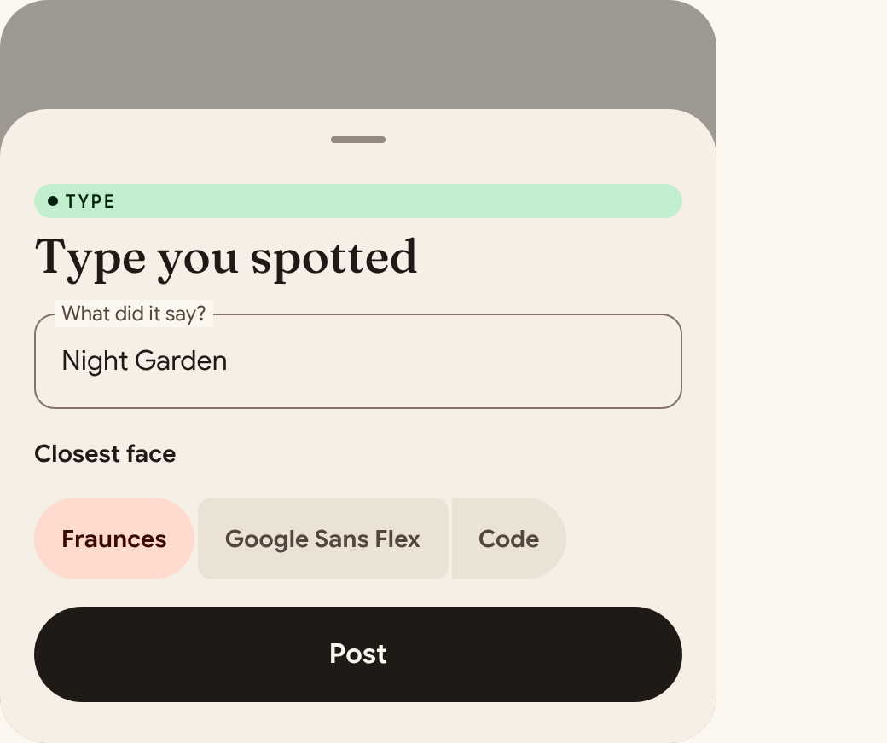</picture><br><sub>Modal sheet that rises from the bottom with a drag handle and shape-xl top corners over a scrim.</sub></td><td width="50%" valign="top"><b><a href="components/Card/README.md">Card</a></b><br><picture><source media="(prefers-color-scheme: dark)" srcset="assets/components/Card-dark.png">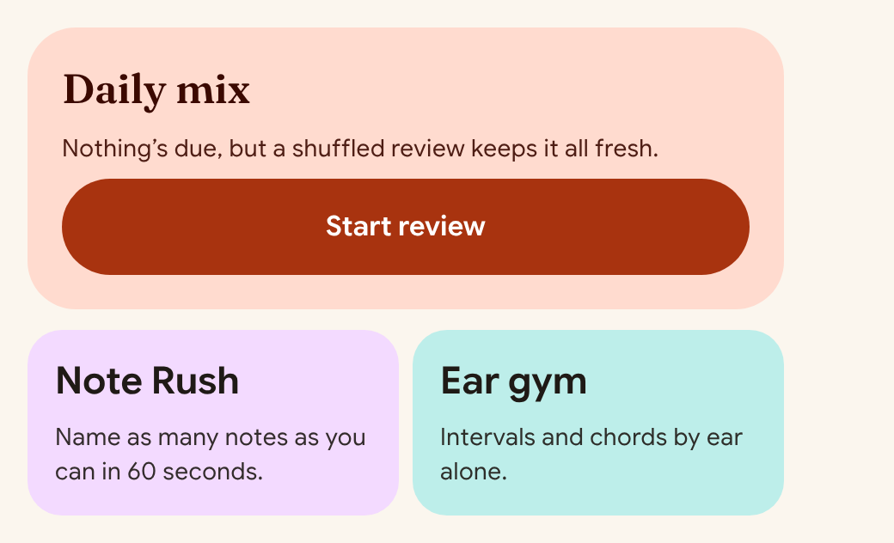</picture><br><sub>Rounded container that separates content by tone, not by shadow.</sub></td></tr>
<tr><td width="50%" valign="top"><b><a href="components/GroupedList/README.md">GroupedList</a></b><br><picture><source media="(prefers-color-scheme: dark)" srcset="assets/components/GroupedList-dark.png">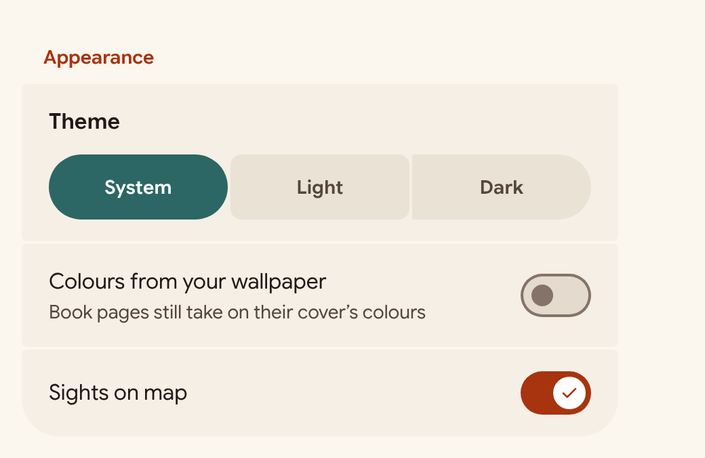</picture><br><sub>Settings-style group: stacked segments 2px apart, large outer corners, small inner corners.</sub></td><td width="50%" valign="top"><b><a href="components/ListItem/README.md">ListItem</a></b><br><picture><source media="(prefers-color-scheme: dark)" srcset="assets/components/ListItem-dark.png">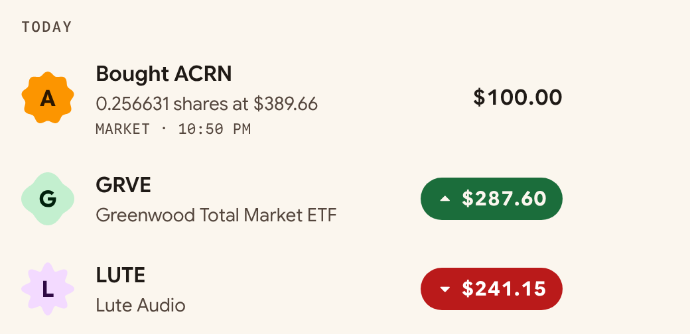</picture><br><sub>One row of a list: leading visual, headline, supporting text, optional mono meta line and a trailing value.</sub></td></tr>
<tr><td width="50%" valign="top"><b><a href="components/StatTile/README.md">StatTile</a></b><br><picture><source media="(prefers-color-scheme: dark)" srcset="assets/components/StatTile-dark.png">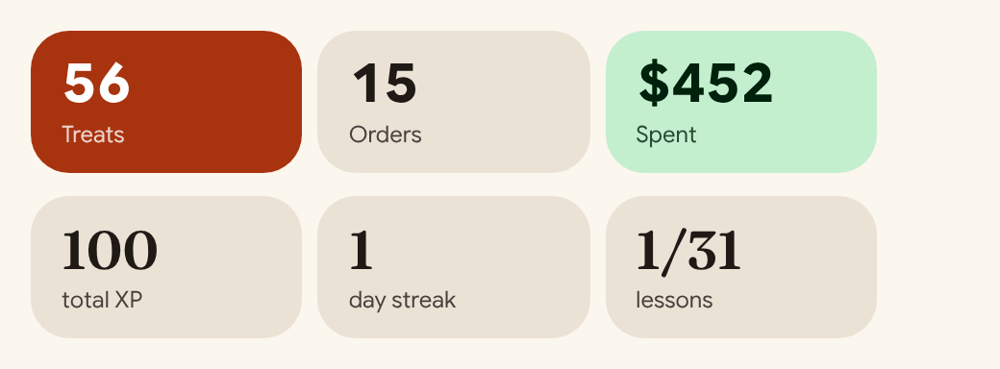</picture><br><sub>A number with a short label, laid out in a row of two to four tiles.</sub></td><td width="50%" valign="top"><b><a href="components/SummaryList/README.md">SummaryList</a></b><br><picture><source media="(prefers-color-scheme: dark)" srcset="assets/components/SummaryList-dark.png">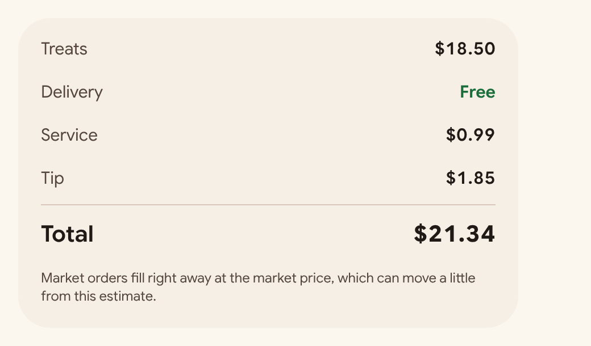</picture><br><sub>Receipt-style key/value rows in a rounded container, with an optional emphasised total.</sub></td></tr>
</table>

### Identity

<table>
<tr><td width="50%" valign="top"><b><a href="components/ShapeAvatar/README.md">ShapeAvatar</a></b><br><picture><source media="(prefers-color-scheme: dark)" srcset="assets/components/ShapeAvatar-dark.png">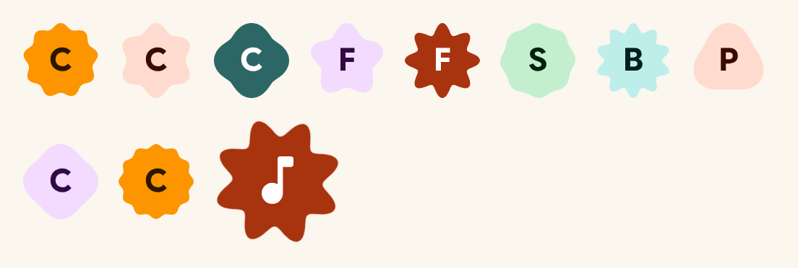</picture><br><sub>Letter, icon or illustration seat cut from the M3 Expressive shape library.</sub></td><td width="50%"></td></tr>
</table>

## M3 Expressive behaviours

The full rules are in [`SKILL.md`](SKILL.md). In short:

1. **Shape morphs.** Pressable things are pills that tighten their corners when pressed; selected segments round into full pills; grouped items sit 2px apart with small inner corners. The [shape library](components/ShapeAvatar/README.md) (cookie, clover, flower, sunny, burst, pebble) seats avatars and heroes.
2. **Motion is springs.** Spatial springs (position, size, shape) may bounce; effects springs (colour, opacity) never do. Fast, default and slow speeds, all interruptible, reduced motion respected.
3. **Emphasis.** One hero per screen in a large numeral or display face, heavier headline and label weights, and an uppercase mono eyebrow above titles.
4. **Containment by tone.** Surface tones and tonal containers separate content; no dividers, no card shadows, no edge stripes.
5. **Colour roles.** `primary` for the main action, matched `*-container` / `on-*-container` pairs, one `highlight` fill per screen, `positive` and `error` always paired with an arrow or icon.
6. **Adaptive.** Navigation bar on compact, rail on medium and up; list and detail from 840dp.
7. **Voice.** Sentence case, second person, buttons that say what they spend, the domain's real units.

## Repository layout

| Path | What |
| --- | --- |
| `SKILL.md` | The AI skill: M3 Expressive behaviours, component and screen patterns, checklist. |
| `tokens/tokens.json` | **Source of truth** for every token. |
| `tokens/tokens.css`, `tokens/tokens.mjs` | Generated CSS variables and type classes; generated JS module. |
| `android/ExpressiveTheme.kt` | Generated Compose theme. |
| `components/bundle.js`, `bundle.css`, `index.d.ts` | The component library (`window.Expressive`), its styles and its types. |
| `components/<Name>/` | `README.md` guideline and `preview.html` example per component; `Cover/` is the design system cover. |
| `docs/` | Brand book, screen patterns, seed palettes. |
| `examples/gallery.html` | Every component on one page. |
| `assets/` | Feature graphic and component images used here and on the website. |
| `scripts/` | Build scripts for tokens, images and the website. |
| `.github/workflows/pages.yml` | Builds and deploys the website on every push to `main`. |

## Development

Change tokens in `tokens/tokens.json` only, then regenerate:

```bash
python3 scripts/build.py
```

Regenerate the README and website images (needs Node 20+ and Playwright):

```bash
npm install --no-save playwright && npx playwright install chromium && node scripts/screenshots.mjs
```

Build and preview the website locally:

```bash
pip install markdown && python3 scripts/build_site.py && python3 -m http.server 8000 --directory _site
```

Then open http://localhost:8000. Check each `on-*` colour pair still meets 4.5:1 in both themes before committing, and commit source and generated files together. The deploy workflow fails if generated files are out of date.

### Website deployment

`.github/workflows/pages.yml` builds the website and the downloadable skill on every push to `main`, then deploys to GitHub Pages. One-time setup: in the repository's Settings → Pages, set **Source** to **GitHub Actions**.

## Credits

Patterns and colours were studied from the Material 3 Expressive sample gallery at m3e.c5inco.dev and from Google's Material 3 Expressive guidance. No illustrations, logos or assets from those apps are included. Fonts and icons load from Google Fonts under their own licences.
